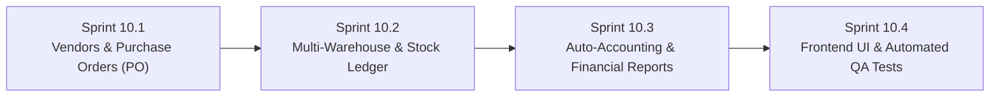

# แผนการพัฒนา Phase 10: ระบบจัดซื้อและใบสั่งซื้อ (PO & Vendors), คลังสินค้าหลายสาขา (Multi-Warehouse) และเชื่อมต่อบัญชีอัตโนมัติ (Auto-Accounting)

**โครงการ:** Senic Billing Next (Multi-Tenant SaaS Billing & Inventory Platform)  
**วันที่จัดทำแผน:** 13 พฤศจิกายน 2026  
**สถานะปัจจุบัน:** ✅ เสร็จสมบูรณ์ 100% (Sprint 10.1 – Sprint 10.4 ดำเนินการและตรวจสอบ Build/Tests ผ่านทั้งหมดแล้ว)

---

## 1. ภาพรวมและวัตถุประสงค์ของ Phase 10

หลังจากที่ Phase 1–9 ได้ครอบคลุมฝั่ง **ขายและภาษีขาย (AR & Output VAT)** รวมถึง **ค่าใช้จ่ายและภาษีซื้อ (AP & Input VAT / 50 ทวิ)** แล้ว ใน **Phase 10** จะเป็นการต่อยอดระบบให้ครบวงจรระดับ ERP สำหรับ SME ไทย ตั้งแต่ต้นน้ำ (**จัดซื้อ / ใบสั่งซื้อ PO -> รับสินค้าเข้าคลังหลายสาขา -> บันทึกสต็อกการ์ดและต้นทุน -> ลงบัญชีคู่ Debit/Credit อัตโนมัติ พร้อมงบทดลองและส่งออกโปรแกรมบัญชี**)

---

## 2. รายละเอียดแผนการพัฒนาแบ่งตามลำดับ (Sequential Sprints 10.1 – 10.4)

### 🟢 Sprint 10.1: ทะเบียนผู้ขาย (Vendor Master) & ระบบใบสั่งซื้อ (Purchase Order — PO)
**ผู้เชี่ยวชาญรับผิดชอบ:** `senic-inventory-pos-specialist`, `senic-ledger`, `senic-sage`, `senic-atlas`

1. **โครงสร้างข้อมูล (`SenicBilling.Domain` & `SenicBillingDbContext`)**
   - สร้างเอนทิตี `Vendor` (แยกตาม `TenantId`): `Name`, `TaxId` (13 หลัก), `Branch` (`00000`), `Address`, `Phone`, `Email`, `ContactPerson`, `PaymentTermsDays`, `DefaultWhtRate`, `DefaultPndType`, `IsActive`
   - สร้างเอนทิตี `PurchaseOrder` และ `PurchaseOrderLine`:
     - `PoNumber` (`PO-YYYYMM-XXXX` ผ่าน `DocumentNumberGeneratorService` ด้วย `DocumentType.PurchaseOrder`)
     - `VendorId`, `VendorName`, `VendorTaxId`, `VendorBranch`, `VendorAddress`
     - `OrderDate`, `ExpectedDeliveryDate`, `WarehouseId` (คลังปลายทางที่จะรับสินค้า)
     - `VatMode` (`Exclusive`/`Inclusive`), `Subtotal`, `DiscountAmount`, `TotalBeforeVat`, `VatRate`, `VatAmount`, `GrandTotal`
     - `Status`: `Draft`, `Sent`, `PartiallyReceived`, `Received`, `Cancelled`
     - `PurchaseOrderLine`: `ProductId`, `Description`, `Quantity`, `ReceivedQuantity`, `Unit`, `UnitPrice`, `DiscountAmount`, `LineTotal`
2. **Backend API (`VendorsController.cs` & `PurchaseOrdersController.cs`)**
   - `/api/vendors`: CRUD ทะเบียนผู้ขายพร้อมค้นหาและกรองตาม `TenantId`
   - `/api/purchase-orders`: CRUD ใบสั่งซื้อ + `POST /api/purchase-orders/{id:guid}/receive`:
     - รับสินค้าเข้าคลัง (รองรับรับบางส่วนหรือรับครบทั้งหมด)
     - เพิ่มสต็อกใน `Product` (และ `ProductWarehouseStock`) พร้อมบันทึก `StockMovement`
     - ตัวเลือก `CreateExpenseRecord = true`: สร้างใบสำคัญจ่าย (`ExpenseRecord`) พร้อมภาษีซื้อ (Input VAT) ให้อัตโนมัติทันทีเมื่อรับสินค้า
   - เพิ่ม `GeneratePurchaseOrderPdf` ใน `QuestPdfService.cs` (`GET /api/purchase-orders/{id:guid}/pdf`)

---

### 🔵 Sprint 10.2: คลังสินค้าหลายสาขา (Multi-Warehouse) และ Stock Movement Ledger
**ผู้เชี่ยวชาญรับผิดชอบ:** `senic-inventory-pos-specialist`, `senic-sage`, `senic-atlas`

1. **โครงสร้างข้อมูล (`Warehouse`, `ProductWarehouseStock`, `StockMovement`)**
   - `Warehouse`: `Code`, `Name`, `Address`, `IsDefault`, `IsActive` (Auto-seed คลังหลัก `"WH-MAIN"` ให้ Tenant ที่ยังไม่มีคลัง)
   - `ProductWarehouseStock`: เก็บ `ProductId`, `WarehouseId`, `Quantity` (`decimal(18,4)`), `ReorderLevel` (`decimal(18,4)`)
   - `StockMovement`: บันทึกความเคลื่อนไหวทุกครั้งที่มีการเข้า-ออกสินค้า (`SaleOut`, `SaleRestock`, `PurchaseIn`, `TransferOut`, `TransferIn`, `Adjustment`), `QuantityDelta`, `BalanceAfter`, `ReferenceNumber`, `Notes`, `CreatedBy`, `CreatedAt`
2. **Backend Service & API (`IInventoryService` & `WarehousesController.cs`)**
   - ซิงค์ยอด `Product.StockQuantity` ให้เท่ากับผลรวมของ `ProductWarehouseStock` ทุกคลังเสมอเพื่อความเข้ากันได้กับหน้า POS / ออกบิลเดิม (Backward-compatible)
   - `GET /api/warehouses` & `POST /api/warehouses`: จัดการคลังสินค้าและดูยอดคงเหลือรายคลัง
   - `POST /api/warehouses/transfer`: โอนย้ายสินค้าระหว่างคลัง (Atomic Transaction ลดคลังต้นทาง + เพิ่มคลังปลายทาง + บันทึก `StockMovement` คู่)
   - `POST /api/warehouses/adjust`: ปรับปรุงยอดสต็อกจากการตรวจนับจริง
   - `GET /api/warehouses/movements` & `GET /api/warehouses/low-stock`: ดู Stock Card ย้อนหลังและรายการสินค้าต่ำกว่าจุดสั่งซื้อ (`ReorderLevel`)

---

### 🟣 Sprint 10.3: ระบบเชื่อมต่อบัญชีอัตโนมัติ (Auto-Accounting Engine) & รายงานทางการเงิน
**ผู้เชี่ยวชาญรับผิดชอบ:** `senic-etax-report-specialist`, `senic-ledger`, `senic-sage`

1. **โครงสร้างข้อมูล (`ChartOfAccount`, `JournalEntry`, `JournalEntryLine`)**
   - `ChartOfAccount`: ผังบัญชีมาตรฐาน SME ไทย (เช่น `1110` เงินสด/ธนาคาร, `1130` ลูกหนี้การค้า, `1150` สินค้าคงเหลือ, `1170` ภาษีซื้อ, `2110` เจ้าหนี้การค้า, `2130` ภาษีขาย, `2140` ภาษีหัก ณ ที่จ่ายค้างจ่าย, `4100` รายได้จากการขาย/บริการ, `5100` ต้นทุนขาย, `5200` ค่าใช้จ่ายดำเนินงาน)
   - `JournalEntry`: `JournalNumber` (`JV-YYYYMM-XXXX`), `EntryDate`, `Description`, `SourceType` (`SalesDocument`, `Payment`, `Expense`, `Manual`), `SourceId`, `SourceNumber`, `IsPosted`
   - `JournalEntryLine`: `AccountId`, `Debit` (`decimal(18,4)`), `Credit` (`decimal(18,4)`), `Memo` (บังคับสมดุล `Sum(Debit) == Sum(Credit)`)
2. **Backend Service & API (`IAccountingService` & `AccountingController.cs`)**
   - Auto-posting เมื่อ:
     - ออกใบกำกับภาษี/ใบเสร็จ: `Dr. ลูกหนี้การค้า` / `Cr. รายได้ + ภาษีขาย`
     - รับชำระเงิน: `Dr. เงินสด/ธนาคาร (+ ภาษีถูกหัก ณ ที่จ่าย)` / `Cr. ลูกหนี้การค้า`
     - บันทึกค่าใช้จ่าย/รับสินค้า PO: `Dr. ค่าใช้จ่าย/สินค้า + ภาษีซื้อ` / `Cr. เจ้าหนี้/เงินสด + ภาษีหัก ณ ที่จ่ายค้างจ่าย`
   - `GET /api/accounting/accounts`, `GET /api/accounting/journals`, `POST /api/accounting/journals` (บันทึกรายวันด้วยตนเอง)
   - `GET /api/accounting/trial-balance` (งบทดลอง) และ `GET /api/accounting/profit-loss` (งบกำไรขาดทุนเบื้องต้น)
   - `GET /api/accounting/export/excel` & `GET /api/accounting/export/csv`: ส่งออกสมุดรายวันสำหรับโปรแกรมบัญชีภายนอก

---

### 🟠 Sprint 10.4: หน้าจอฝั่ง Frontend & ชุดทดสอบอัตโนมัติ (UI & Automated QA)
**ผู้เชี่ยวชาญรับผิดชอบ:** `senic-nova`, `senic-milo`, `senic-argus`

1. **Frontend Pages (`frontend/src/components/...`)**
   - `PurchaseOrdersPage.tsx` (`/purchase-orders`): แท็บจัดการผู้ขาย (Vendors) และใบสั่งซื้อ (PO), Modal สร้าง PO, ปุ่ม **รับสินค้าเข้าคลัง**, และปุ่มพิมพ์ **PO PDF**
   - `WarehousesPage.tsx` (`/warehouses`): จัดการคลังสินค้าหลายสาขา, โอนย้ายสินค้าระหว่างคลัง, ปรับยอดสต็อก, และดูประวัติ Stock Movement + แจ้งเตือนสินค้าใกล้หมด
   - `AccountingPage.tsx` (`/accounting`): ดูสมุดรายวันทั่วไป (Journal Entries), งบทดลอง (Trial Balance), งบกำไรขาดทุนเบื้องต้น (P&L) และส่งออก Excel/CSV
   - เพิ่มเมนูใน `Sidebar.tsx`, `BottomNav.tsx` และ Route ใน `App.tsx`
2. **Automated Tests (`SenicBilling.Tests/Phase10Tests.cs`)**
   - ทดสอบ PO Lifecycle (Create -> Receive -> Stock Increase -> Auto ExpenseRecord)
   - ทดสอบ Multi-Warehouse Transfer (ต้นทางลด ปลายทางเพิ่ม ยอดรวมคงเดิม + StockMovement ครบถ้วน)
   - ทดสอบ Auto-Accounting Double-Entry (`Sum(Debit) == Sum(Credit)`), Trial Balance, และ Tenant Isolation
   - ยืนยัน `dotnet build`, `dotnet test`, และ `npm run build` ผ่าน 100%

---

## 3. เกณฑ์การตรวจรับผลงาน (Definition of Done — Phase 10)
- [x] สร้างผู้ขาย (`Vendor`) ออกใบสั่งซื้อ (`PO-YYYYMM-XXXX`) พิมพ์ PO PDF และรับสินค้าเข้าคลังพร้อมสร้าง Expense อัตโนมัติได้
- [x] บริหารจัดการคลังสินค้าหลายสาขา โอนย้าย/ปรับยอดสต็อก และตรวจสอบ Stock Movement ย้อนหลังได้ครบถ้วน
- [x] ระบบลงสมุดรายวันบัญชีคู่ (`Debit == Credit`) อัตโนมัติ ดูงบทดลอง/งบกำไรขาดทุน และส่งออกไฟล์ Excel/CSV ได้
- [x] `dotnet build`, `dotnet test`, `npm run lint` และ `npm run build` ผ่าน 100% (`0 Errors, 0 Warnings`, `Passed: 21/21`)

