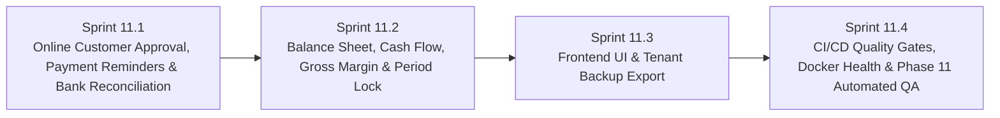

# แผนการพัฒนา Phase 11: Customer Online Approval, Bank Reconciliation, Financial Statements & E2E Production Hardening

**โครงการ:** Senic Billing Next (Multi-Tenant SaaS Billing & Inventory Platform)  
**วันที่จัดทำแผน:** 13 พฤศจิกายน 2026  
**สถานะปัจจุบัน:** ✅ เสร็จสมบูรณ์ 100% (Sprint 11.1 – Sprint 11.4 Verified)

---

## 1. ภาพรวมและวัตถุประสงค์ของ Phase 11

หลังจาก Phase 1–10 ได้วางรากฐานครบตั้งแต่การขาย เอกสารภาษี/e-Tax, คลังสินค้าหลายสาขา, จัดซื้อ PO, ค่าใช้จ่าย 50 ทวิ, LINE OA, และระบบลงบัญชีคู่อัตโนมัติ (Trial Balance / P&L) แล้ว ใน **Phase 11** จะยกระดับแพลตฟอร์มสู่มาตรฐาน Production ERP & Customer Experience ครบทุกมิติ:

---

## 2. รายละเอียดแผนการพัฒนาแบ่งตามลำดับ (Sequential Sprints 11.1 – 11.4)

### 🟢 Sprint 11.1: Customer Online Approval, Bank Statement Reconciliation & Payment Reminders
**ผู้เชี่ยวชาญรับผิดชอบ:** `senic-billing-specialist`, `senic-backend-engineer`, `senic-ai-automation-specialist`, `senic-security-reviewer`

1. **ระบบยืนยันและลงนามเอกสารออนไลน์ (Online Quotation / Document Approval)**
   - [x] เพิ่ม Enum `CustomerApprovalStatus` (`Pending`, `Approved`, `Rejected`) และฟิลด์บน `DocumentHeader` (`CustomerApprovalStatus`, `ApprovedByName`, `ApprovedAt`, `CustomerSignatureText`, `CustomerApprovalComment`, `LastReminderSentAt`)
   - [x] เพิ่ม Public Endpoints ใน `SharedDocumentController.cs`:
     - `POST /api/documents/{id:guid}/public/approve`: บันทึกผู้ลงนาม + ลายเซ็น/ความเห็น (ป้องกันเอกสารสถานะ `Cancelled`), บันทึก `AuditLog`, แจ้งเตือน Real-time via SignalR (`DocumentApproved`) และ LINE (`ILineNotifyService`)
     - `POST /api/documents/{id:guid}/public/reject`: บันทึกการขอแก้ไข/ไม่อนุมัติ พร้อมเหตุผลและแจ้งเตือน Real-time/LINE (`DocumentRejected`)
2. **ระบบแจ้งเตือนวางบิลและทวงหนี้อัตโนมัติ (Automated & 1-Click Payment Reminders)**
   - [x] อัปเกรด `OverdueMonitorWorker.cs` ให้แจ้งเตือนทั้ง Email + LINE Tenant เมื่อบิลเปลี่ยนเป็น `Overdue` และแจ้งเตือนล่วงหน้าก่อนครบกำหนด (`DueDate` ภายใน 3 วัน) โดยใช้ `LastReminderSentAt` ป้องกันการส่งซ้ำถี่เกิน 24 ชั่วโมง
   - [x] เพิ่ม `POST /api/documents/{id:guid}/send-reminder` ใน `SharedDocumentController.cs` ให้พนักงานกดส่งแจ้งเตือนวางบิล/ชำระเงินได้ทันที
3. **ระบบกระทบยอดเงินโอนเข้าบัญชี (Bank Statement Reconciliation)**
   - [x] สร้างเอนทิตี `BankStatementTransaction` (`BankReconciliation.cs`) แยกตาม `TenantId`
   - [x] พัฒนา `BankReconciliationController.cs` (`/api/bank-reconciliation`):
     - `GET /transactions` + แนะนำคู่จับคู่ (Suggested Document / Expense) จากยอดเงินและเลขที่เอกสาร
     - `POST /import` (รองรับรายการ JSON และ CSV Bank Statement)
     - `POST /auto-reconcile` (จับคู่รายการที่มีความมั่นใจสูงอัตโนมัติ -> เปลี่ยนบิลเป็น `Paid`, บันทึก `PaymentTransaction`, และลงบัญชี `PostPaymentAsync`)
     - `POST /transactions/{id:guid}/match` & `/ignore`, `GET /candidates`

---

### 🔵 Sprint 11.2: รายงานการเงินและบัญชีขั้นสูง (Balance Sheet, Cash Flow, Gross Margin & Period Lock)
**ผู้เชี่ยวชาญรับผิดชอบ:** `senic-etax-report-specialist`, `senic-billing-specialist`, `senic-backend-engineer`, `senic-solution-architect`

1. **ต้นทุนสินค้าและวิเคราะห์กำไรขั้นต้น (Cost Price & Gross Margin Analytics)**
   - [x] เพิ่ม `CostPrice` (`decimal?(18,4)`) ใน `Product`, DTOs (`ProductDto`, `CreateProductRequest`, `UpdateProductRequest`), และ `ProductsController`
   - [x] เพิ่ม `GET /api/accounting/sales-margin`: วิเคราะห์รายได้, ต้นทุนขาย (อ้างอิง `Product.CostPrice` หรือต้นทุนเฉลี่ยจากการรับสินค้า PO), กำไรขั้นต้น, % Margin แยกตาม **สินค้า**, **พนักงานขาย (`CreatedBy`)**, และสรุปรวม
2. **งบดุลและงบกระแสเงินสด (Balance Sheet & Cash Flow Statement)**
   - [x] เพิ่ม `GET /api/accounting/balance-sheet`: คำนวณ **สินทรัพย์ = หนี้สิน + ส่วนของเจ้าของ (รวมกำไรสะสม/สุทธิถึงวันที่เลือก)** จาก `JournalEntryLines`
   - [x] เพิ่ม `GET /api/accounting/cash-flow`: คำนวณ **งบกระแสเงินสดทางตรง (Direct Method)** บนบัญชีเงินสด `1110` (Opening Cash + Inflows จากรับชำระ/ขายสด - Outflows จากค่าใช้จ่าย/เจ้าหนี้ = Ending Cash)
   - [x] เพิ่ม `GET /api/accounting/export/financial-statements-excel`: ส่งออก Workbook รวมทั้ง **งบดุล**, **งบกำไรขาดทุน**, และ **งบกระแสเงินสด** (`ClosedXML`)
3. **ระบบปิดงวดบัญชี (Accounting Period Lock)**
   - [x] สร้างเอนทิตี `AccountingPeriodLock` (`TenantId`, `Year`, `Month`, `IsLocked`, `LockedAt`, `LockedBy`, `Notes`) พร้อม Unique Index `(TenantId, Year, Month)`
   - [x] เพิ่ม `IsPeriodLockedAsync` และ `EnsurePeriodUnlockedAsync` ใน `IAccountingService` / `AccountingService` เพื่อป้องกันการสร้าง/แก้ไข/ยกเลิก/ลงบัญชีในงวดที่ปิดแล้ว across `AccountingController`, `DocumentControllerBase`, `TaxInvoiceController`, `ExpensesController`, และ `BankReconciliationController`
   - [x] เพิ่ม Endpoints `/api/accounting/periods`, `/periods/lock`, `/periods/unlock` (Admin + AuditLog)

---

### 🟣 Sprint 11.3: หน้าจอ Frontend ครบวงจร & ระบบสำรองข้อมูลระดับองค์กร (UI & Tenant Backup Export)
**ผู้เชี่ยวชาญรับผิดชอบ:** `senic-frontend-engineer`, `senic-design-specialist`, `senic-security-reviewer`

1. **Frontend UI (`frontend/src/...`)**
   - [x] อัปเกรด `DocumentPrintView.tsx` ให้ลูกค้าปลายทางกด **อนุมัติ/ลงนามเอกสารออนไลน์** หรือ **ขอแก้ไข** พร้อมแสดงสถานะการอนุมัติและผู้ลงนาม
   - [x] อัปเกรด `DocumentsListPage.tsx` เพิ่ม Badge สถานะการอนุมัติจากลูกค้า และปุ่ม **ส่งแจ้งเตือนชำระเงิน (Send Reminder)**
   - [x] สร้างหน้า `BankReconciliationPage.tsx` (`/bank-reconciliation`) + เพิ่มเมนูนำทางใน `Sidebar.tsx` / `BottomNav.tsx` / `App.tsx` สำหรับนำเข้า CSV สเตทเมนท์, กระทบยอดอัตโนมัติ 1-Click, และจับคู่รายการแบบ Manual
   - [x] อัปเกรด `AccountingPage.tsx` เพิ่มแท็บ **งบดุล (Balance Sheet)**, **งบกระแสเงินสด (Cash Flow)**, **กำไรขั้นต้น (Margin Analytics)**, และ **ปิดงวดบัญชี (Period Lock)** พร้อมปุ่ม Export Financial Statements Excel
   - [x] เพิ่มช่อง **ราคาทุนต่อหน่วย (`costPrice`)** ใน `ProductsPage.tsx`
2. **ระบบสำรองข้อมูลแยกตามองค์กร (Tenant Data Backup Export)**
   - [x] เพิ่ม `GET /api/tenants/backup/export` ใน `TenantsController.cs` (สิทธิ์ Admin เท่านั้น, ส่งออก `.zip` รวมไฟล์ JSON ของข้อมูลทั้งหมดภายใน Tenant อย่างปลอดภัยและไม่มีข้อมูลข้าม Tenant)
   - [x] เพิ่มการ์ด `TenantBackupCard.tsx` สำหรับ **ดาวน์โหลดไฟล์สำรองข้อมูลองค์กร (.zip)** ใน `SettingsPage.tsx`

---

### 🟠 Sprint 11.4: E2E Quality Gates, DevOps Hardening & Automated Verification
**ผู้เชี่ยวชาญรับผิดชอบ:** `senic-qa-engineer`, `senic-devops-engineer`, `senic-learning-cycle`

1. **EF Core Migration & Schema Synchronization**
   - [x] สร้าง EF Core Migration `AddPhase11ApprovalReconciliationPeriodLock` สำหรับฟิลด์และตารางใหม่ทั้งหมด
2. **DevOps & CI/CD Hardening**
   - [x] เพิ่ม Readiness Endpoint `/health` และ `/api/health` ใน `Program.cs`, ติดตั้ง `curl` ใน `backend/Dockerfile`, และเพิ่ม `healthcheck` ใน `docker-compose.yml` สำหรับ `database`, `backend`, `minio`
   - [x] อัปเกรด `.github/workflows/ci-cd.yml` ให้รัน Job `quality-checks` (`dotnet test`, `frontend` lint/build/test, `admin-frontend` lint/build) ก่อน `build-and-push` และ `deploy`
3. **Automated Tests & Quality Verification**
   - [x] สร้างชุดทดสอบ `Phase11EnterpriseTests.cs` ทดสอบ Online Approval/Reject, Bank Statement CSV Import & Auto-Reconciliation, Balance Sheet equation (`Assets == Liabilities + Equity`), Cash Flow continuity, Sales Margin analytics, Accounting Period Lock/Unlock enforcement, และ Tenant Backup ZIP isolation
   - [x] สร้างชุดทดสอบ Frontend Unit & Integration Contract Tests (`frontend/scripts/phase11-unit.test.mjs`) พร้อมอัปเดตเอกสารแผนงานและ `.ai-agents/knowledge/`
   - [x] ยืนยัน `dotnet build`, `dotnet test`, `frontend` (`npm run lint`, `npm run build`, `npm test`), และ `admin-frontend` (`npm run lint`, `npm run build`) ผ่าน 100%

---

## 3. เกณฑ์การตรวจรับผลงาน (Definition of Done — Phase 11)
- [x] ลูกค้าสามารถเปิดลิงก์สาธารณะเพื่ออนุมัติ/ลงนาม หรือขอแก้ไขเอกสารได้จริง พร้อมแจ้งเตือน Real-time & LINE และบันทึก AuditLog
- [x] นำเข้า Bank Statement (CSV/JSON) กระทบยอดอัตโนมัติหรือจับคู่ Manual แล้วปิดยอดบิลเป็น `Paid` พร้อมลงบัญชีคู่ให้อัตโนมัติ
- [x] แสดง **งบดุล (Balance Sheet)**, **งบกระแสเงินสด (Cash Flow)**, **วิเคราะห์กำไรขั้นต้น (Margin)**, และ **ปิดงวดบัญชี (Period Lock)** ใช้งานได้ครบทั้ง Backend/Frontend และส่งออก Excel ได้
- [x] ผู้ดูแลองค์กรสามารถดาวน์โหลดไฟล์ Backup `.zip` เฉพาะ Tenant ของตนได้ และ CI/CD + Docker Compose มี Health Check + Test Gate ครบถ้วน
- [x] `dotnet build`, `dotnet test`, `npm run lint`, `npm run build`, `npm test` ผ่านทั้งหมด `0 errors`
