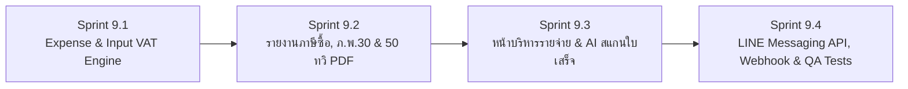

# แผนการพัฒนา Phase 9: ระบบใบสำคัญจ่าย/ภาษีซื้อ (Expense & Input VAT), หนังสือรับรองหัก ณ ที่จ่าย (50 ทวิ) และ LINE Messaging API / AI OCR

**โครงการ:** Senic Billing Next (Multi-Tenant SaaS Billing & Inventory Platform)  
**วันที่จัดทำแผน:** 13 พฤศจิกายน 2026  
**สถานะปัจจุบัน:** ✅ เสร็จสมบูรณ์ 100% (Sprint 9.1 – Sprint 9.4 ดำเนินการและตรวจสอบ Build/Tests ผ่านทั้งหมดแล้ว)

---

## 1. ภาพรวมและวัตถุประสงค์ของ Phase 9

หลังจากที่โครงการได้พัฒนาฝั่ง **รายได้และภาษีขาย (Accounts Receivable & Output VAT)** ครบวงจรใน Phase 1–8 แล้ว ใน **Phase 9** นี้จะเป็นการเติมเต็มฝั่ง **รายจ่าย ภาษีซื้อ และภาษีหัก ณ ที่จ่าย (Accounts Payable, Input VAT & Withholding Tax)** เพื่อให้ผู้ประกอบการ SME ไทยสามารถใช้ **Senic Billing Next** บริหารภาษีมูลค่าเพิ่มสุทธิ (**ภ.พ.30 = ภาษีขาย - ภาษีซื้อ**) ออกหนังสือรับรองการหักภาษี ณ ที่จ่าย (**50 ทวิ**) เตรียมยื่น **ภ.ง.ด.3 / ภ.ง.ด.53** และเชื่อมต่อกับ **LINE Official Account (LINE Messaging API & Webhook)** ได้อย่างสมบูรณ์

---

## 2. รายละเอียดแผนการพัฒนาแบ่งตามลำดับ (Sequential Sprints 9.1 – 9.4)

### 🟢 Sprint 9.1: ระบบบันทึกค่าใช้จ่าย / ใบสำคัญจ่าย และภาษีซื้อ (Expense Voucher & Input VAT Engine)
**ผู้เชี่ยวชาญรับผิดชอบ:** `senic-etax-report-specialist`, `senic-ledger`, `senic-sage`, `senic-atlas`

1. **การออกแบบโครงสร้างข้อมูล (`SenicBilling.Domain` & `SenicBillingDbContext`)**
   - สร้างเอนทิตี `ExpenseRecord` (สืบทอด `BaseEntity` และ `ITenantEntity`) รองรับ `decimal(18,4)` ทุกฟิลด์ตัวเลข:
     - `VoucherNumber`: เลขที่ใบสำคัญจ่ายอัตโนมัติ (รูปแบบ `EXP-YYYYMM-XXXX` ผ่าน `DocumentNumberSequence`)
     - `ExpenseDate`: วันที่เกิดรายการจ่าย
     - `TaxInvoiceNumber` & `TaxInvoiceDate`: เลขที่และวันที่ใบกำกับภาษีซื้อที่ได้รับจากผู้ขาย (Vendor)
     - `VendorName`, `VendorTaxId` (13 หลัก), `VendorBranch` (`00000` สำนักงานใหญ่ หรือรหัสสาขา), `VendorAddress`
     - `Category`: หมวดหมู่ค่าใช้จ่าย (`CostOfGoods` ต้นทุนสินค้า/วัตถุดิบ, `RentAndUtilities` ค่าเช่าและสาธารณูปโภค, `ProfessionalService` ค่าบริการวิชาชีพ/จ้างทำของ, `Marketing` ค่าโฆษณา/การตลาด, `OfficeSupplies` อุปกรณ์สำนักงาน, `Transportation` ค่าขนส่ง, `Other` อื่นๆ)
     - `Description`: รายละเอียดค่าใช้จ่าย
     - `VatCalculationMode`: `Exclusive` (แยกนอก), `Inclusive` (รวมใน), หรือ `NoVat` (ไม่มี VAT)
     - `Subtotal`, `DiscountAmount`, `TotalBeforeVat`, `VatRate` (ค่าเริ่มต้น `7.0000`), `VatAmount` (ภาษีซื้อ)
     - `IsRefundableVat`: ระบุว่าเป็น **ภาษีซื้อขอคืนได้ (Claimable Input VAT)** หรือ **ภาษีซื้อต้องห้าม (Non-claimable)**
     - `WhtRate` (`0`, `1`, `2`, `3`, `5` %), `WhtAmount` (ภาษีหัก ณ ที่จ่าย), `PndType` (`None`, `PND3` บุคคลธรรมดา, `PND53` นิติบุคคล), `IncomeTypeDescription` (เช่น ค่าจ้างทำของ, ค่าบริการ, ค่าเช่า)
     - `GrandTotal` (`TotalBeforeVat + VatAmount`) และ `NetPaidAmount` (`GrandTotal - WhtAmount`)
     - `Status`: `Draft`, `Approved`, `Paid`, `Cancelled`
     - `AttachmentUrl`, `Notes`
2. **พัฒนา `ExpensesController.cs` (`/api/expenses`)**
   - `GET /api/expenses`: ดึงรายการค่าใช้จ่ายของ Tenant พร้อมตัวกรอง `year`, `month`, `category`, `pndType`, `status`, และ `search` + สรุปยอดรวมประจำเดือน
   - `GET /api/expenses/{id:guid}`: ดูรายละเอียดใบสำคัญจ่ายรายใบ
   - `POST /api/expenses`: บันทึกใบสำคัญจ่ายใหม่ รันเลข `EXP-YYYYMM-XXXX` คำนวณ `VatAmount` และ `WhtAmount` ตามหลักสรรพากร (`MidpointRounding.AwayFromZero`)
   - `PUT /api/expenses/{id:guid}` และ `POST /api/expenses/{id:guid}/cancel`: แก้ไขและยกเลิกใบสำคัญจ่าย
3. **เชื่อมต่อยอดภาษีซื้อเข้ากับ `DashboardController.GetTaxEstimator`**
   - คำนวณ `TotalPurchases` และ `TotalPurchaseVat` จาก `ExpenseRecords` ในเดือน/ปีที่เลือก (เฉพาะรายการที่ `Status != Cancelled` และ `IsRefundableVat == true`)
   - คำนวณ `EstimatedTaxPayable = TotalSalesVat - TotalPurchaseVat` เพื่อให้ผู้ประกอบการทราบยอดภาษีมูลค่าเพิ่มสุทธิประจำเดือน (ภ.พ.30) ทันที

---

### 🔵 Sprint 9.2: รายงานภาษีซื้อ (Input Tax Report), สรุป ภ.พ.30 และหนังสือรับรองหัก ณ ที่จ่าย (50 ทวิ PDF)
**ผู้เชี่ยวชาญรับผิดชอบ:** `senic-etax-report-specialist`, `senic-ledger`, `senic-sage`

1. **รายงานภาษีซื้อประจำเดือน Excel (`GET /api/reports/input-tax/export`)**
   - ใช้ `ClosedXML` สร้างไฟล์ Excel มาตรฐานกรมสรรพากร ประกอบด้วย:
     - **Sheet 1 (`รายงานภาษีซื้อ`)**: ลำดับที่, วัน/เดือน/ปีใบกำกับภาษี, เลขที่ใบกำกับภาษีซื้อ, ชื่อผู้ขายสินค้า/ผู้ให้บริการ, เลขประจำตัวผู้เสียภาษี 13 หลัก, สถานประกอบการ (สนญ./สาขา), มูลค่าสินค้า/บริการ, จำนวนเงินภาษีมูลค่าเพิ่ม, จำนวนเงินรวม และหมายเหตุ
     - **Sheet 2 (`สรุปภาษี ภ.พ.30`)**: ตารางเปรียบเทียบยอดขาย/ภาษีขาย (Output VAT) หักลบด้วยยอดซื้อ/ภาษีซื้อขอคืนได้ (Input VAT) แสดงผลลัพธ์ว่าเป็น **ภาษีที่ต้องชำระเพิ่ม** หรือ **ภาษีชำระเกินยกไป**
2. **รายงานภาษีหัก ณ ที่จ่าย ภ.ง.ด.3 และ ภ.ง.ด.53 Excel (`GET /api/reports/wht/export`)**
   - สร้างไฟล์ Excel แยกตามประเภทแบบยื่น (`PND3` บุคคลธรรมดา / `PND53` นิติบุคคล) แสดงลำดับ, ชื่อและเลขผู้เสียภาษีของผู้ถูกหัก, ที่อยู่, วันเดือนปีที่จ่าย, ประเภทเงินได้, อัตราภาษี (%), จำนวนเงินที่จ่าย และภาษีที่หักนำส่ง
3. **สร้าง PDF หนังสือรับรองการหักภาษี ณ ที่จ่าย (50 ทวิ) (`GET /api/expenses/{id:guid}/wht-certificate-pdf`)**
   - พัฒนา `GenerateWhtCertificatePdf` ใน `QuestPdfService.cs` สำหรับสร้างเอกสาร **หนังสือรับรองการหักภาษี ณ ที่จ่าย ตามมาตรา 50 ทวิ แห่งประมวลรัษฎากร** รูปแบบมาตรฐาน A4 รองรับฟอนต์ภาษาไทย พร้อมข้อมูลผู้มีหน้าที่หักภาษี ณ ที่จ่าย (Tenant), ผู้ถูกหักภาษี ณ ที่จ่าย (Vendor), ประเภทแบบ (`ภ.ง.ด.3` / `ภ.ง.ด.53`), ตารางประเภทเงินได้พึงประเมิน และยอดเงินตัวอักษรภาษาไทย (`ThaiBahtText`)

---

### 🟣 Sprint 9.3: หน้าจอบริหารค่าใช้จ่าย ใบสำคัญจ่าย และ AI สแกนใบเสร็จอัตโนมัติ (Expense UI & Gemini AI Receipt Scanner)
**ผู้เชี่ยวชาญรับผิดชอบ:** `senic-nova`, `senic-milo`, `senic-ai-automation-specialist`

1. **AI สแกนและสกัดข้อมูลใบเสร็จ/ใบกำกับภาษีซื้อ (`POST /api/ai-assistant/parse-expense`)**
   - ขยายความสามารถของ `IGeminiAIAssistantService` และ `GeminiAIAssistantService` ให้รับข้อความจากใบเสร็จ/สลิป หรือข้อมูล OCR แล้วสกัดออกมาเป็นโครงสร้าง JSON (`ParsedExpenseDto`: ชื่อร้านค้า/ผู้ขาย, เลขผู้เสียภาษี 13 หลัก, เลขที่ใบกำกับภาษี, วันที่, ยอดก่อนภาษี, VAT 7%, ยอดรวม, หมวดหมู่แนะนำ และอัตราหัก ณ ที่จ่ายที่เหมาะสม)
2. **หน้าบริหารค่าใช้จ่ายและภาษีซื้อ (`frontend/src/components/expenses/ExpensesPage.tsx`)**
   - เพิ่มเมนู **"ค่าใช้จ่าย / ภาษีซื้อ" (Expenses & Input VAT)** ใน `Sidebar.tsx` และ `App.tsx` (`/expenses`)
   - แสดงการ์ดสรุป 4 รายการ: ยอดรายจ่ายรวมเดือนนี้, ภาษีซื้อขอคืนได้ (Input VAT), ภาษีหัก ณ ที่จ่ายรอนำส่ง (WHT ภ.ง.ด.3/53), และจำนวนใบสำคัญจ่าย
   - ตารางรายการค่าใช้จ่ายพร้อมปุ่มดาวน์โหลด **รายงานภาษีซื้อ (Excel)**, **รายงาน ภ.ง.ด.3/53 (Excel)** และปุ่มดาวน์โหลด **หนังสือรับรอง 50 ทวิ (PDF)** รายรายการ
   - Modal สร้าง/แก้ไขใบสำคัญจ่าย พร้อมปุ่ม **"กรอกอัตโนมัติด้วย AI (Smart Receipt Parser)"** และคำนวณ VAT/WHT แบบ Real-time
3. **อัปเดตหน้า `DashboardPage.tsx` (การ์ดประมาณการภาษี ภ.พ.30)**
   - แสดงตัวเลข **ภาษีขาย (Output VAT)** คู่กับ **ภาษีซื้อ (Input VAT)** และ **ยอดภาษีสุทธิที่ต้องชำระ (Net VAT Payable)** พร้อมปุ่มดาวน์โหลดทั้งรายงานภาษีขายและรายงานภาษีซื้อ

---

### 🟠 Sprint 9.4: การเชื่อมต่อ LINE Messaging API & Webhook แบบสองทิศทาง และชุดทดสอบอัตโนมัติ (LINE OA Integration & Automated QA)
**ผู้เชี่ยวชาญรับผิดชอบ:** `senic-ai-automation-specialist`, `senic-aegis`, `senic-argus`

1. **ขยายการรองรับ LINE Official Account (LINE Messaging API)**
   - เพิ่มฟิลด์การตั้งค่าใน `Tenant` (`LineChannelAccessToken`, `LineChannelSecret`, `LineDefaultTargetId`) ควบคู่กับ `LineNotifyToken` เดิม
   - อัปเกรด `LineNotifyService` ให้รองรับการส่งผ่านทั้ง **LINE Messaging API (Push Message / Flex Summary)** และ **LINE Notify API** (Fallback อัตโนมัติตามค่าที่องค์กรตั้งไว้)
   - เพิ่มส่วนตั้งค่า LINE Official Account (Messaging API) และปุ่มทดสอบส่งข้อความในหน้า `SettingsPage.tsx`
2. **พัฒนา `LineWebhookController.cs` (`POST /api/webhooks/line/{tenantId:guid}`)**
   - ตรวจสอบความถูกต้องของ `X-Line-Signature` ด้วย `HMAC-SHA256` จาก `LineChannelSecret` ของ Tenant เพื่อความปลอดภัยตามมาตรฐาน OWASP
   - รองรับคำสั่งแชทอัตโนมัติสำหรับผู้บริหาร/ทีมบัญชีใน LINE OA:
     - พิมพ์ `"สรุปยอด"` หรือ `"ยอดขาย"` -> ตอบกลับยอดขายรวม ยอดรับชำระ และยอดค้างชำระเดือนปัจจุบัน
     - พิมพ์ `"ภาษี"` หรือ `"ภพ30"` -> ตอบกลับสรุปภาษีขาย ภาษีซื้อ ประมาณการ ภ.พ.30 และยอดหัก ณ ที่จ่ายประจำเดือน
     - พิมพ์เลขที่เอกสาร (เช่น `"INV-202611-0001"`) -> ตอบกลับสถานะเอกสาร ยอดสุทธิ และลิงก์เปิดดูบิล/ชำระเงินออนไลน์
3. **การทดสอบอัตโนมัติ (`SenicBilling.Tests`)**
   - เพิ่ม Unit & Integration Tests ทดสอบ:
     - การสร้าง `ExpenseRecord` และการคำนวณภาษีซื้อ (`Input VAT`) + ภาษีหัก ณ ที่จ่าย (`WHT 50 ทวิ`)
     - การคำนวณภาษีมูลค่าเพิ่มสุทธิ (`Output VAT - Input VAT`) ใน `DashboardController.GetTaxEstimator`
     - การสร้าง PDF หนังสือรับรอง 50 ทวิ และรายงานภาษีซื้อ Excel
     - การตรวจสอบลายเซ็น `HMAC-SHA256` และการประมวลผลคำสั่งใน `LineWebhookController`

---

## 3. เกณฑ์การตรวจรับผลงาน (Definition of Done — Phase 9)
- [x] บันทึก แก้ไข ยกเลิกใบสำคัญจ่าย/ค่าใช้จ่าย (`ExpenseRecord`) พร้อมคำนวณภาษีซื้อ (Input VAT) และหัก ณ ที่จ่าย (WHT) ได้อย่างแม่นยำระดับ `decimal(18,4)`
- [x] ดาวน์โหลด **รายงานภาษีซื้อ + สรุป ภ.พ.30 (Excel)**, **รายงาน ภ.ง.ด.3/53 (Excel)** และ **หนังสือรับรองหัก ณ ที่จ่าย 50 ทวิ (PDF)** ได้จากหน้าเว็บ
- [x] ฟีเจอร์ AI วิเคราะห์ข้อความใบเสร็จ (`parse-expense`) ช่วยกรอกฟอร์มค่าใช้จ่ายได้อัตโนมัติ
- [x] ระบบเชื่อมต่อ LINE Messaging API & Webhook พร้อมตรวจสอบ `X-Line-Signature` ทำงานได้ครบถ้วน
- [x] `dotnet build`, `dotnet test`, และ `npm run build` ผ่าน 100% (`0 Errors, 0 Warnings`, `Passed: 11/11`)

